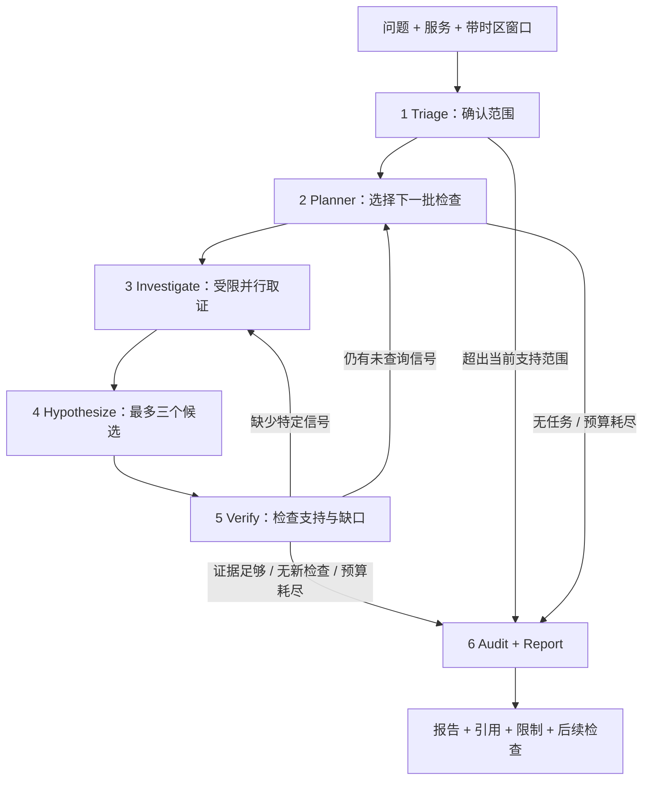

# AegisRCA：架构决策与边界

目标是构建一个围绕事故提出候选解释、调用只读遥测工具、根据证据补查并给出可核验报告的调查助手。第一阶段以个人作品集和可复现实验为目标，定位为 **Evidence-Driven Incident Investigation**。

当前版本 0.2 已实现调查闭环、三个后端 adapter、快照回放、确定性分析、有预算的可选 LLM、离线评分器和本地任务 API。真实 OTel 遥测与真实模型调用尚未验收。默认演示与随仓库提供的快照都是人工数据；具体执行结果见 [验证记录](validation.md)。

## 1. 对原方案的调整

| 原设计 | 采用的设计及原因 |
| --- | --- |
| 先实现四个自治 specialist | 一个调查 controller 加三类受控工具；确有专业检索策略收益时再拆 |
| Payment unreachable 就定位 Payment 根因 | 分开受影响服务、失败调用边、故障模式、底层原因；客户端配置错误不等于服务端崩溃 |
| 缺失 server span 可以否定应用错误 | 缺失首先是未观测到；采样、查询、埋点和导出问题尚未排除 |
| 两种信号意味着独立证据 | 同一 RPC 的 log 与 trace 可能相关；核对不同必要命题，不重复计为独立试验 |
| 固定加权分数就是 HIGH confidence | 使用明确证据门槛与保留意见；未经校准的分数不能叫正确概率 |
| Hybrid RAG 必须先做 | 日志先用 lexical/context；检索召回成为瓶颈后再验证插件、mapping 和 embedding |
| Fault flags 是完整 ground truth | 注入记录只提供变更标签；可回答层级、归因与语义支持另行标注 |
| Audit 不通过就无限补查 | 所有补查共享预算；没有新证据时给出部分发现或 INCONCLUSIVE |
| checkpoint 自动解决恢复 | 持久化、任务 ID、幂等、重试和费用账本需要共同设计 |

## 2. 六阶段调查闭环

`graph.py` 用 LangGraph 串行控制节点和 `Send` worker 子图执行。每轮由 controller 先裁剪剩余额度，再并行派发；worker 不自行追加查询。worker 只产生 evidence、findings 和 tool call records，候选解释和报告由串行节点管理。

默认规则先查询 metric/trace，看到指向 Payment 的 RPC UNAVAILABLE 后补查 log。若 LLM 先选择 log，Verify 仍会补查 trace。每类信号最多尝试一次，没有隐式 retry。当前 Triage 只接受单一 `checkout` seed；这是明确的起步范围，不是通用服务定位能力。

可选 LLM 只参与 Planner 和 Hypothesizer。模型选择允许的 signal/services/goal，不能生成任意 URL、PromQL 或可执行操作。失败、结构不合法、引用越界或模型预算耗尽时回退确定性策略。模型提出的候选保持 uncertain，已确认结论仍要经过下述固定证据规则。

## 3. 数据与来源契约

| 对象 | 实现和限制 |
| --- | --- |
| IncidentInput / IncidentScope | 显式服务、问题与带时区的半开窗口 `[start,end)` |
| InvestigationTask | 稳定 ID、signal、服务、时间范围；每 task 一次 backend 查询 |
| MetricSeries / SpanRecord / LogRecord | HTTP adapter 规范化后的遥测；保留 labels/attributes、原文、后端来源与截断信息 |
| Evidence | 不可变 ID、结构化 observation、最多 2,000 字符片段、source pointer、相关组；由受限解析器派生 |
| Finding | 局部观察与 evidence IDs；当前包装已保留片段，不做自由文本 LLM 提炼 |
| Hypothesis | failure mode、支持/反证引用、缺少的检查、状态；默认固定候选，可选模型提出候选 |
| ToolCallRecord | 尝试、成功/空/错误/超时、证据引用、warnings、truncated、coverage_complete |
| IncidentReport | 状态、诊断层级、底层原因、claims、限制、后续检查、停止原因、数据模式与推理模式 |
| TelemetrySnapshot | schema_version、incident、来源模式、规范化遥测和 collection_errors；不等同于原始 HTTP wire dump |
| Catalog | metric names/labels、服务、日志 mapping 的显式发现；尚无完整后端能力协商 |
| Topology / Timeline | 观测依赖和事件时间线；不自动补全缺失边或声称因果传播路径 |

证据 ID 包括来源和内容摘要，span 还区分 trace ID/span ID，log 区分 document ID。reducer 幂等且与合并顺序无关；相同 ID 内容不同直接拒绝。重复证据不重复加分。

原始规范化遥测存快照，图状态保留有界证据与引用。客户端、模型实例和内存调用账本通过 runtime 注入；模型密钥不进入 state、报告或配置 dump。遥测属于不可信数据，不能变成任务指令或扩大工具权限。

快照文件使用独占创建，禁止覆盖。CLI 每次调查新建 UUID 目录；显式输出目录也必须是新路径。派生分析文件可以重新生成。`synthetic_fixture`、`snapshot`、`live` 标记数据模式，`deterministic` / `llm_assisted` 单独标记模型参与；人工回放仍标 synthetic。

## 4. 结论层级与审计

用证据约束报告精度：

1. **症状：** checkout 出现错误。
2. **故障位置/模式：** checkout 向 payment 建立连接失败。
3. **底层原因：** checkout 使用了错误 endpoint；需要配置或部署差异等额外证据。
4. **修复效果：** 更正 endpoint 后在可比较负载下恢复；需要变更和恢复验证。

当前规则确认第二层的必要条件是：checkout 的 CLIENT trace 明确向 payment 发出 RPC 并出现 UNAVAILABLE，加上能明确归属于 payment 的拒绝连接或 DNS 解析失败日志。单独的状态码、缺失 server span、泛泛的 Payment 文本或成功的 name resolution 日志均不满足规则。

满足条件时报告 `SUPPORTED + diagnosis_level=failure_mode`，`underlying_cause=null`。这表示观测到故障模式，不能等同于已经定位唯一根因。log 与 trace 不必然独立，也未证明影响全部请求。

`report.py` 根据结构化 observation 检查固定句式，**不是通用自然语言蕴含校验器**。LLM 的任意 prose 不会自动升级为已确认 claim。未来扩大自由文本报告前，需增加 claim extraction、逐条引用与语义支持评审。

时间先后不等于因果；span 缺失不证明请求没到；低 CPU 不排除连接池、线程池或队列问题。观测拓扑只用同一 trace 的父子关系或显式 CLIENT peer，不补造缺失的调用边。

## 5. 后端与分析边界

| 组件 | 当前实现 |
| --- | --- |
| JsonHttp | 固定配置地址、只读 GET/受限 `_search` POST、响应体上限、连接/读取超时、无重试/重定向 |
| Prometheus | catalog 和 query_range；非有限值告警，按应用的 `[start,end)` 过滤 |
| Jaeger | 公共 v3 QueryService、OTLP resourceSpans、分页/截断元数据；异常或 404 不能解释为“没有事故” |
| OpenSearch | lexical 搜索、trace context、mapping；处理分片失败、超时、截断及可配置字段 |
| Metric analysis | median/MAD 与明确的绝对变化阈值；样本不足和零 MAD 不生成虚假显著性 |
| Counter rate | 排序后计算，reset 区间省略并告警，不臆测重置期间增量 |
| ReplayBackend | 查询窗口与服务必须在录制范围内；保留采集错误；使用与 LiveBackend 相同的证据解析器 |
| Knowledge search | 尚未实现；后续根据检索失败案例决定 |

默认 `metric_query=null`，需先发现真实 catalog 再配置只读 PromQL。分析 CLI 能比较 baseline/incident，但当前调查规则不会把没有配置阈值的任意 metric 数组当作异常证据。

解析规则与目标后端契约见 [Backend contracts](backend-contracts.md)。真实响应兼容性仍要用部署后的数据验证，MockTransport 测试只证明对测试响应的处理行为。

## 6. 固定实验环境与故障录制

下载器固定 OTel Demo **3.0.0** tag。Compose 生成脚本同时固定 `DEMO_VERSION` / `IMAGE_VERSION` 并检查应用镜像标签，因为下载源码中的 `.env` 默认值仍为 latest。当前固定到 tag，尚未额外锁定所有镜像 digest。

在该版本源文件中，目标 flag 为 `paymentUnreachable` 与 `paymentFailure`，对应启用 variant 分别为 `on` 与 `100%`。前者在 checkout 侧切换错误 payment 地址。人工快照并不宣称复现该 flag 的真实错误原文。[固定版本 Checkout 源码](https://github.com/open-telemetry/opentelemetry-demo/blob/3.0.0/src/checkout/main.go)、[固定版本 flags](https://github.com/open-telemetry/opentelemetry-demo/blob/3.0.0/src/flagd/demo.flagd.json)。

Compose 使用独立项目名与网络，所有 host port 绑定 localhost。flagd 与 flagd-ui 共用项目内的配置副本。独立录制脚本先检查 catalog、获取文件锁、备份，再注入并在 `finally` 恢复。它不属于调查 Agent 的工具，注入权限不会交给 LLM。

注入审计保存在 private；遥测先进入 quarantine，避免 feature flag 字段泄漏答案。脚本取消/失败恢复已有测试，但强杀和掉电仍需人工核对备份与锁。采集前 catalog 可达也不能替代真实业务负载和恢复验收。

## 7. 预算、超时和恢复

默认最多 3 轮、6 次工具尝试、每次 5 秒、调查 deadline 120 秒。模型使用独立的调用次数、输入/输出 token 预留、价格和总 deadline 预算，默认费用预留上限 0.25 USD。调用前原子预留，失败不退款；记录的是保守预留，不能当作 provider 实际计费量。完整规则见 [LLM setup](llm-setup.md)。

全局 deadline 到达时，runner 合并内存中的已完成 worker 结果，再把尚未结束的尝试记为 timeout。一个慢工具不会抹掉同批其他工具已获得的证据。最后一次额度获得的有效结论仍可报告。

`asyncio` 超时是协作式取消。同步 HTTP 放在工作线程中，取消等待无法强杀正在执行的线程；实际停止仍受 HTTP timeout 约束，因此不承诺硬实时的进程退出期限。

API 以 UUID 持久化终态，重启后遗留 queued/running 任务标为 interrupted。**尚未提供 LangGraph checkpoint 或中断续跑。** 内存账本、证据去重和终态文件都不是跨进程 exactly-once 网络执行保证。

## 8. 实施顺序

现阶段采用 Python、Pydantic、LangGraph、httpx、FastAPI/uvicorn 与 pytest；无需先引入 Kubernetes、Neo4j、Kafka 或多个编排框架。

下一轮优先修复 Docker 外部环境、采集健康/故障/恢复快照并校验适配器，再进行真实模型预算验收和独立 episode 对照。API 网页、持久化恢复、agent 自身 tracing、Knowledge RAG 和 specialist 拆分分别列为后续工作。逐项状态见 [路线图](roadmap.md)。
